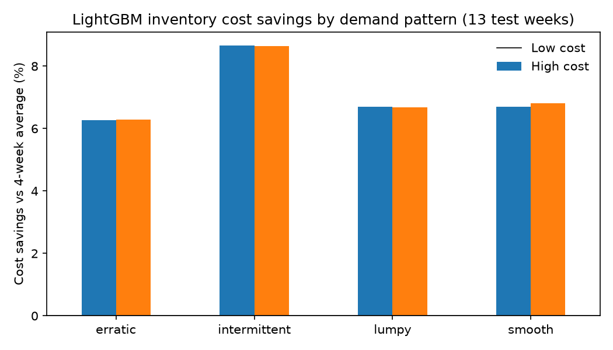

# Walmart Demand Forecasting and Inventory Cost Trade-off

## Problem

A demand planning manager must decide where additional forecasting effort is worth the time and complexity, because not every product or store benefits equally from a more sophisticated forecast. This project compares simple forecasting methods with a machine-learning approach across Walmart's three Texas stores, measuring forecast accuracy and translating errors into estimated overstock and stockout costs under stated cost assumptions. The analysis examines stores, categories, and demand patterns, such as intermittent sales and event or SNAP days, to identify where improved forecasting creates measurable economic value. A useful answer shows where a more sophisticated forecast justifies its added complexity and where a simple approach is already sufficient.

## Key findings

- **LightGBM beats the best simple method, but modestly.** On a 13-week holdout across 9,147 product-store series, weighted MAPE fell from 0.363 (4-week moving average) to 0.341, a 6.1% improvement. RMSE fell 8.7%, so the gain is largest on big misses.
- **The gain holds up in dollars.** Converted to overstock and stockout costs, LightGBM saved 6.4% to 7.4% ($9,609 to $26,313 over 13 weeks) under all four cost scenarios tested. It passed in every demand pattern, store, category, and department.
- **The savings come from carrying less stock.** 88% to 94% of the savings are lower overstock cost. Tighter errors mean less safety stock for the same stockout rate (7.9% vs 8.0%).
- **The value is concentrated.** LightGBM saves money under every scenario for only 42.7% of series, and the top 10% of series produce 90% to 107% of net savings. A planner gets most of the benefit by focusing attention on a small set of items.
- **Where it pays and where simple is enough.** FOODS saves 8.0% to 10.1% (FOODS_3 up to 11.8%); smooth series produce about half the dollar savings because they carry 73% of volume. HOBBIES_2 saves $13 to $140 in 13 weeks: the 4-week average is enough there.
- **A surprise.** Intermittent series had the highest percentage savings (7.9% to 9.1%), against the common assumption that complex models add little on sparse demand.



## Data

M5 Forecasting (Kaggle): daily unit sales for 3,049 products across 10 Walmart stores, January 2011 to May 2016, with prices, events, and SNAP days. This project uses the three Texas stores (TX_1, TX_2, TX_3), which gives 9,147 product-store series and 19,228,405 units sold.

The data is not included in this repo. Download it from the [M5 Forecasting - Accuracy](https://www.kaggle.com/competitions/m5-forecasting-accuracy) competition page.

## Approach

**0. Reshape** (`01_reshape.ipynb`). Filtered the wide sales file (one column per day) to the 3 Texas stores and reshaped it to one row per product, store, and day: 17,754,327 rows. Category and `int16` dtypes cut memory from 525 MB to 213 MB (59%). A total-units check confirmed nothing was lost. Saved as Parquet.

**1. Join** (`02_join.ipynb`, DuckDB SQL). LEFT JOINed sales to the calendar on day and to weekly prices on store, item, and week, after proving each lookup table had one row per key so the join couldn't duplicate sales. Row count and total units matched before and after. 19.2% of product-store-days have no price, and none of them have sales: a missing price means the item wasn't on the shelf yet, not missing data. Rolled days up to 277 complete weeks (2,533,719 rows); the final partial week was dropped.

**2. Demand patterns and data quality** (`03_eda.ipynb`). Dropped weeks before each item's first priced week (all zero sales), then classified every series with the Syntetos-Boylan method (ADI and CV²):

| Pattern | Series | % of series | % of units |
|---|---|---|---|
| Smooth | 4,402 | 48.1 | 73.2 |
| Intermittent | 3,104 | 33.9 | 11.3 |
| Erratic | 699 | 7.6 | 11.5 |
| Lumpy | 942 | 10.3 | 4.0 |

Flagged 35 item-store combinations priced under $0.10 (likely a pricing data quirk) and checked the largest single-day sales (634 units).

**3. Forecasting** (`04_forecast.ipynb`). One-week-ahead weekly forecasts. Time-based split: train on weeks 1 to 251, validate on 252 to 264, test on the last 13 weeks. Lag and rolling-average features built with SQL window functions.

- Simple methods: last week (naive), 4-week average, 13-week average. The 4-week average won on validation.
- LightGBM: one global model with a Tweedie objective, early stopping on validation.

| Method | WMAPE | MAE | RMSE | Bias |
|---|---|---|---|---|
| LightGBM | 0.341 | 2.955 | 6.226 | -1.8% |
| 4-week average | 0.363 | 3.144 | 6.818 | -0.7% |
| 13-week average | 0.402 | 3.483 | 7.821 | -3.6% |
| Naive | 0.402 | 3.475 | 7.037 | -0.3% |

Recent sales history drives the model: the 4-week average, last week's sales, and the 13-week average account for 95% of feature importance. Price, SNAP, and event features add little at weekly level.

**4. Forecast error to inventory cost** (`05_inventory_cost.ipynb`). Each week the planner orders the forecast plus safety stock. Safety stock is z × σ, where σ is each method's own error spread per series on the validation weeks and z comes from the newsvendor critical ratio. Overstock and stockout units are priced at each item's shelf price.

**5. Dashboard.** Power BI. [PLACEHOLDER: link or screenshot once built]

## Cost assumptions

M5 has no holding, stockout, or margin data. All dollar figures come from the stated assumptions below, not Walmart's real costs. Every result is reported under all four combinations.

| Cost | Low | High |
|---|---|---|
| Overstock, per unit per week (holding, markdown, spoilage) | 5% of price | 15% of price |
| Stockout, per unit (lost margin and goodwill) | 20% of price | 50% of price |

"Measurable economic value" was defined before running the analysis: LightGBM's savings over the best simple method stay positive under all four scenarios.

## Limitations

- Cost rates are assumptions, so the relative pattern matters more than the dollar totals.
- Order quantities are continuous; no case packs, lead times, or shelf limits.
- The test period is 13 weeks.
- LightGBM's validation errors, used for its safety stock, come from the same weeks used for early stopping. This slightly understates its safety stock and works against it.

## How to run

Tested on macOS with Python 3.12.

```bash
git clone https://github.com/rajisworking16/walmart-demand-forecasting.git
cd walmart-demand-forecasting
python3.12 -m venv .venv
source .venv/bin/activate
python -m pip install -r requirements.txt
brew install libomp   # needed by LightGBM on macOS
```

Download the M5 files from Kaggle and unzip them into `~/data/walmart-data/raw/`. Data paths are set in `src/config.py`; change `DATA_DIR` there if your data lives somewhere else.

Run the notebooks in order:

1. `notebooks/01_reshape.ipynb`
2. `notebooks/02_join.ipynb`
3. `notebooks/03_eda.ipynb`
4. `notebooks/04_forecast.ipynb`
5. `notebooks/05_inventory_cost.ipynb` (also writes the dashboard CSVs to `~/data/walmart-data/dashboard/`)

## Repo structure

```
notebooks/         one notebook per stage
src/config.py      data paths, imported by every notebook
sql/               DuckDB queries
reports/figures/   charts used in this README
.vscode/           editor settings
requirements.txt   pinned package versions
```

## Tools

Python (pandas, LightGBM, SciPy, matplotlib), DuckDB SQL, Parquet, Power BI.
